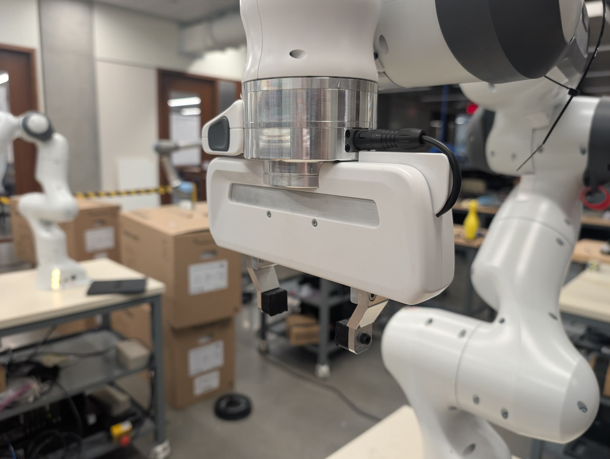
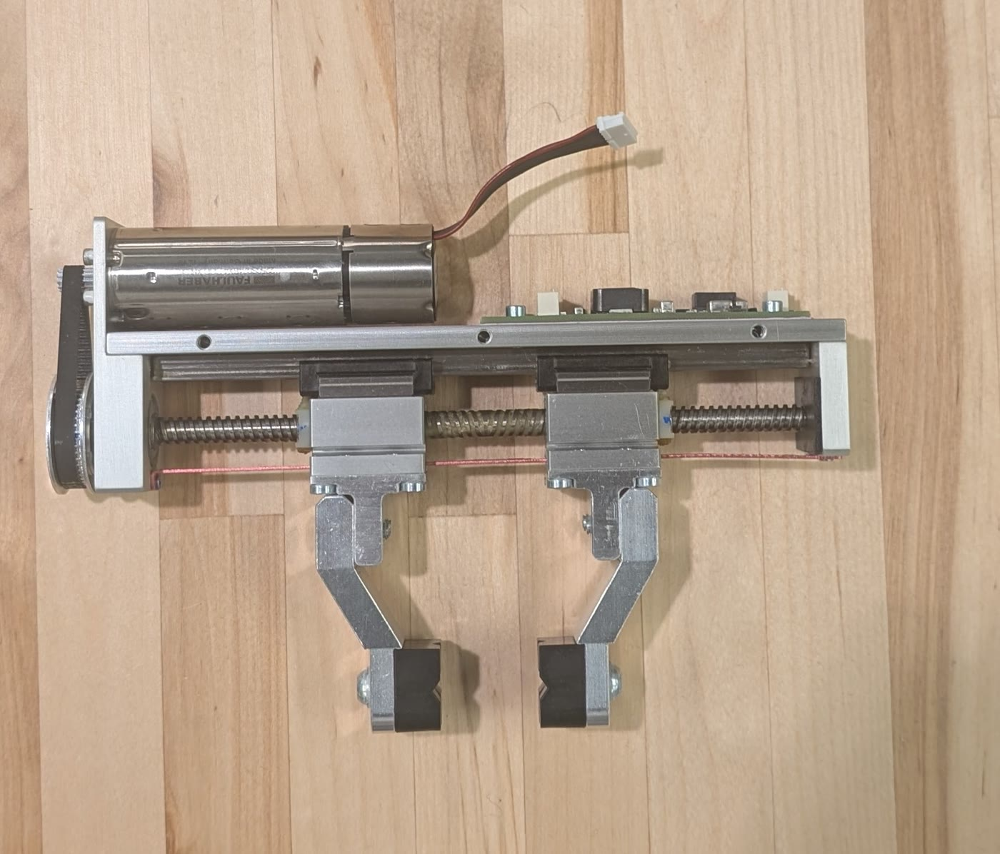
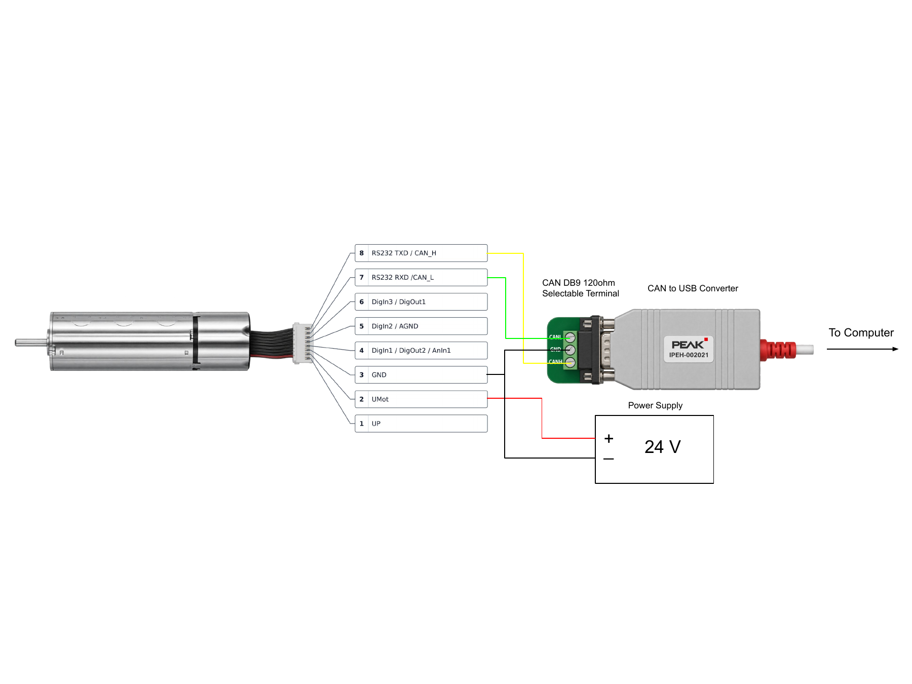
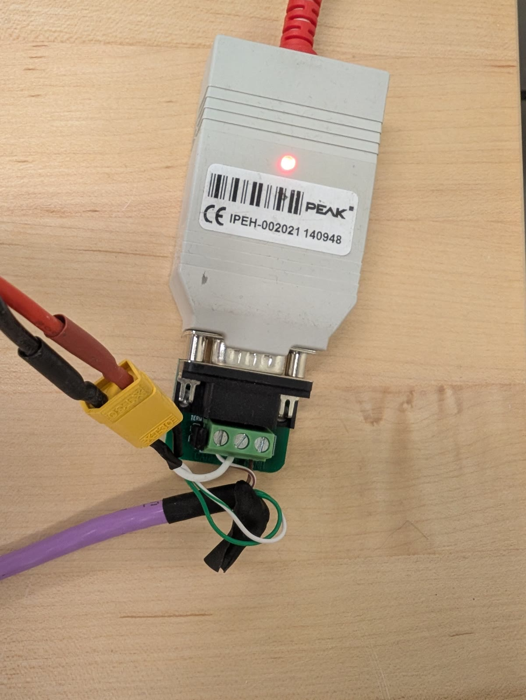
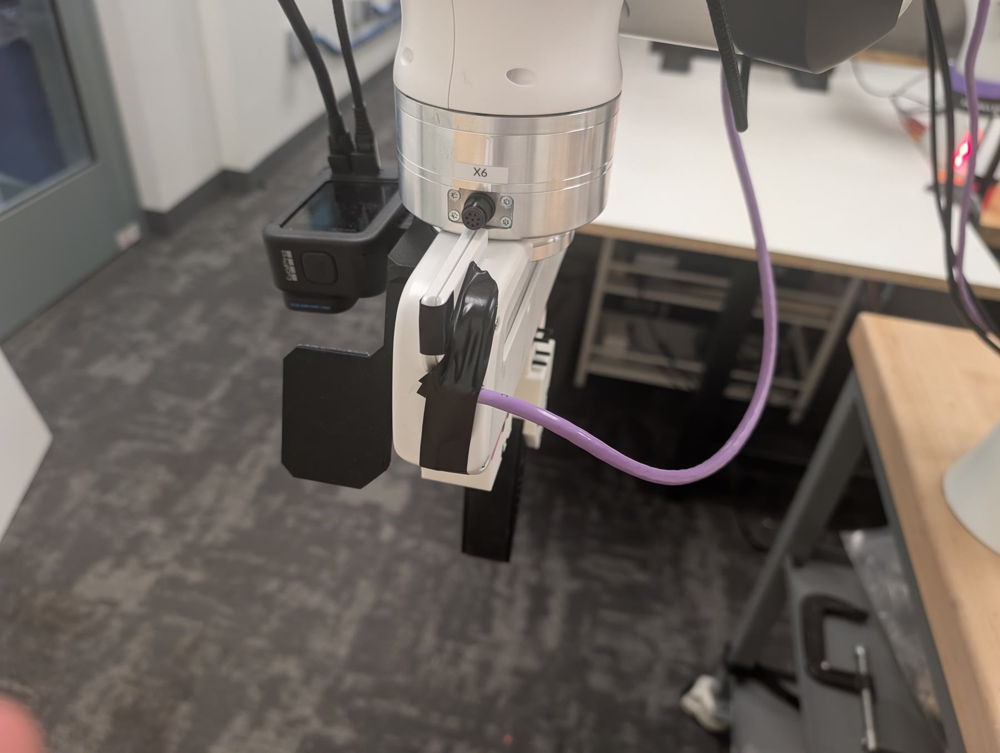

# FAULHABER Gripper Control

This ROS 2 package controls a FAULHABER-driven gripper over CANopen. It provides:

- a ROS 2 node that accepts timestamped `JointTrajectory` chunks and tracks them
  in Cyclic Synchronous Position (CSP) mode;
- a ROS-independent Python API for applications that want to control the motor
  directly;
- repeatable mechanical hard-stop calibration with persistent travel limits;
- measured width, motor current, and waypoint tracking-error telemetry; and
- a read-only connection checker for diagnosing SocketCAN and CANopen without
  enabling or moving the drive.

To assemble the hardware, start with the
[hardware build guide](#hardware-build-guide). To get the software running,
jump to the [Quickstart](#quickstart). If CANopen is new to you, the
[CAN and CANopen glossary](#can-and-canopen-glossary) briefly defines the
protocol terms used throughout this README.

The user-facing gripper convention is:

| Quantity | Convention |
|---|---|
| Closed width | `0.0 mm` in the Python API, `0.0 m` in ROS |
| Open width | `max_width_mm`, `81.2 mm` by default |
| Raw closed coordinate | Calibrated `safe_min` |
| Raw open coordinate | Calibrated `safe_max` |

## Architecture

```text
JointTrajectory publisher
          |
          v
ROS callback: validate, convert metres -> millimetres, merge trajectory chunks
          |
          v
Thread-safe waypoint buffer <---- ROS time / simulated time
          |
          v
200 Hz CSP worker -------------> monotonic scheduling and lateness checks
          |
          v
FaulhaberCSPMotor: limits, calibration conversion, lifecycle, safe teardown
          |
          v
python-can / SocketCAN ---- CANopen RPDO + SYNC / TPDO feedback ---- Drive
          ^                                                        |
          +------ statusword, position, and motor current ----------+
```

## Vendor documentation

The exact vendor revisions used to document this implementation are stored in
[`docs/`](docs/README.md):

- [CANopen Communication / Function Manual 7000.05037](docs/EN_7000_05037_CANopen_Communication_Function_Manual.pdf),
  2nd edition, 2018-11-09; and
- [2250 ... BX4 IMC RS/CO product datasheet](docs/EN_2250_BX4_IMC_RSCO_DFF.pdf),
  2026-07-28 edition.

Inline citations below link to the first relevant PDF page. The
[`docs` index](docs/README.md) contains a page map and SHA-256 checksum for each
unchanged source document.

## Hardware build guide

This guide describes how to construct the cable and perform the wiring nessesary for directly controling the Franka Hand motor over CAN. 

### Step 1: Obtain the components

| Component | Purpose and notes |
|---|---|
| [Purple Cat 6 Ethernet patch cable](https://www.amazon.com/dp/B06XBWPBHK) | Sacrificial multi-conductor cable. 
| [InnoMaker CAN DB9 120-ohm selectable terminal](https://www.amazon.com/dp/B0BD7CDQ31) | Breaks the PCAN adapter's DB9 connection out to `CANL`, `GND`, and `CANH`. It also adds the nessesary 120 Ohm resistor. |
| [MEAN WELL LRS-200-24 power supply](https://www.digikey.com/en/products/detail/mean-well-usa-inc/LRS-200-24/7705026) | Regulated 24 V supply. |
| [PEAK PCAN-USB adapter, IPEH-002021](https://phytools.com/products/pcan-usb-adapter) | Connects the CAN bus to the Linux computer over USB. |
| [Molex Pico-SPOX eight-position right-angle header, 0874380843](https://www.digikey.com/en/products/detail/molex/0874380843/699152) | Mating header used to connect the cable harness to the motor connector. |


### Step 2: Remove the gripper mechanism

Detach the Franka Hand from the robot. Disassemble the outer casing and extract its internals. Detach the existing cable that connects the internal PCB the Franka Arm. 



*The assembled gripper attached to the Franka Arm before the outer shell is removed.*



*Extracted gripper internals.*

### Step 3: Build the wiring harness

| Motor connection | Function | Connect to |
|---:|---|---|
| 2 | `UMot` | Power-supply `+24 V` |
| 3 | `GND` | Power-supply `-V` and CAN terminal `GND` at the shared ground junction |
| 7 | `CAN_L` | CAN terminal `CANL` |
| 8 | `CAN_H` | CAN terminal `CANH` |



The original, zoomable version is available as
[wiring-diagram.pdf](docs/build-guide/wiring-diagram.pdf).

Lop off both ends of the ethernet cable. Select five wires within the ethernet cable and use that to wire up up the components as depicted in the wiring diagram. Use XT30 connectors to connect the power and ground wires to the power supply so that power can be easily disconnected. The connections between the ethernet cable, CAN DB9 adapter, and power supply are shown below. 



*PCAN-USB adapter, DB9 terminal board, and the purple cable breakout. The wire with the XT30 connector goes to the power supply.*


### Step 4: Reassemble the gripper

Route the purple cable out of the outer shell. You may need to remove some insulation from the ethernet cable so that the wires fit through the hole.



*Reassembled gripper with the purple cable routed out of the closed shell.*

### Step 5: Apply power

Connect the PCAN-USB adapter to the computer. Clear the gripper workspace, keep
an emergency disconnect within reach, and energize the 24 V supply.

Continue with the [Quickstart](#quickstart)
to configure `can0`, run the non-moving connection check, and start the ROS 2
node.

## Quickstart

This path covers a new checkout through first commanded motion. It assumes:

- ROS 2, `colcon`, and `rosdep` are installed and the ROS installation is
  sourced;
- the motor/controller is powered and wired to a Linux CAN adapter according
  to the exact product datasheet;
- the CAN bus is terminated with 120 ohms at each physical end; and
- the default controller settings are node ID `1` and `500000` bit/s.

Replace the interface, node ID, or bitrate in the commands below if your setup
differs. Only one program should control a CANopen node at a time.

### 1. Clone, build, and source

If the repository is not already in a ROS 2 workspace, clone it into the
workspace's `src` directory:

```bash
mkdir -p ~/ros2_ws/src
cd ~/ros2_ws/src
git clone https://github.com/anunthramaswami2030/franka_gripper_control.git
cd ~/ros2_ws
rosdep install --from-paths src --ignore-src -r -y
colcon build --packages-select franka_gripper_control
source install/setup.bash
```

The runtime dependencies are ROS 2 `rclpy`, `trajectory_msgs`,
`sensor_msgs`, `std_msgs`, `std_srvs`, and Python `python-can`. The host also
needs `iproute2` to inspect/configure SocketCAN; `can-utils` is optional but
useful for diagnosis.

### 2. Bring up the CAN interface

SocketCAN is the Linux interface to a CAN adapter; it exposes the bus as a
network device such as `can0`. Configure it before starting the node. Every
device on the physical bus must use the same bitrate:

```bash
sudo ip link set can0 down
sudo ip link set can0 type can bitrate 500000
sudo ip link set can0 up
ip -details -statistics link show can0
```

A healthy idle interface normally reports `can state ERROR-ACTIVE` with zero
live transmit and receive error counters. `ERROR-WARNING`, `ERROR-PASSIVE`, or
`BUS-OFF` usually indicates a bitrate, wiring, termination, power, or node
configuration problem.

### 3. Check the connection without moving the motor

Stop other software that accesses this CANopen node, then run:

```bash
python3 -m franka_gripper_control.check_faulhaber_connection \
  --interface can0 \
  --node-id 1
```

Continue only when the final line reports `RESULT: HEALTHY`. The checker reads
controller state and CAN error counters but does not enable or move the drive.

The checker:

1. records the kernel CAN state and error counters;
2. sends a node-guard remote request
   ([CANopen manual, pp. 30–31](docs/EN_7000_05037_CANopen_Communication_Function_Manual.pdf#page=30));
3. reads device type, statusword, active mode, position, velocity, and current
   with expedited SDO uploads
   ([CANopen manual, pp. 22–24](docs/EN_7000_05037_CANopen_Communication_Function_Manual.pdf#page=22));
4. passively observes boot-up, emergency, and CAN error frames
   ([CANopen manual, pp. 25–26](docs/EN_7000_05037_CANopen_Communication_Function_Manual.pdf#page=25)); and
5. verifies that kernel error counters did not increase.

It does **not** send NMT state changes, Controlwords, mode writes, PDOs, SYNC,
or motion targets. A healthy result verifies communication; it does not verify
that motion is mechanically safe.

Useful checker options are:

| Option | Default | Meaning |
|---|---:|---|
| `--interface` | `can0` | SocketCAN interface |
| `--node-id` | `1` | CANopen node ID, from 1 through 127 |
| `--samples` | `10` | Number of statusword samples |
| `--interval` | `0.5` s | Passive observation time after each sample |
| `--response-timeout` | `1.0` s | Per-request timeout |

### 4. Start the ROS node

Create the default calibration directory if this is the first run:

```bash
mkdir -p ~/.ros
```

Start the node with the normal ROS clock:

```bash
ros2 launch franka_gripper_control faulhaber_gripper.launch.xml
```

The node first tries to load the existing calibration file and enter CSP. If
that fails—for example, on first use when the file does not exist—the ROS node
remains available but ignores trajectories until calibration succeeds.

### 5. Calibrate once

If a valid calibration file already exists for this exact mechanism, skip this
step. Otherwise, clear the complete gripper travel, keep an emergency stop
available, and run from another sourced terminal:

```bash
ros2 service call \
  /faulhaber_gripper/calibrate \
  std_srvs/srv/Trigger \
  "{}"
```

Wait for `success: true`. The default launch file saves calibration at:

```text
~/.ros/faulhaber_gripper_limits.json
```

Do not reuse this file for a different gripper or after changing gripper tips.

### 6. Send a first trajectory

Publish a two-point test trajectory from another sourced terminal. ROS joint
positions are in **metres**, so `0.04` means a 40 mm opening. Replace it with a
known-safe width if 40 mm is not appropriate for your mechanism:

```bash
ros2 topic pub --once \
  /polyumi/target_gripper \
  trajectory_msgs/msg/JointTrajectory \
  "{joint_names: [fr3_gripper_width], points: [
    {positions: [0.0], time_from_start: {sec: 0, nanosec: 0}},
    {positions: [0.04], time_from_start: {sec: 2, nanosec: 0}}
  ]}"
```

For the first accepted trajectory after startup or calibration, the node
replaces the first point's width with the measured current width. Its timestamp
is retained, so the second point above produces a smooth two-second motion from
the physical starting position to `0.04 m`. A one-point first message only
establishes a hold and therefore does not move the gripper.

Confirm measured width and motor current in separate sourced terminals:

```bash
ros2 topic echo /faulhaber_gripper/joint_states
ros2 topic echo /faulhaber_gripper/motor_current_ma
```

### 7. Shut down

Press `Ctrl+C` in the launch terminal. Normal shutdown stops the CSP scheduler,
disables the drive, restores temporary PDO mappings and current limits, and
closes the CAN connection. After the node has exited, the host interface can be
taken down if desired:

```bash
sudo ip link set can0 down
```

## ROS node API

### Subscribed topic

| Default topic | Type | Units | Description |
|---|---|---|---|
| `/polyumi/target_gripper` | `trajectory_msgs/msg/JointTrajectory` | metres in `positions` | Timestamped chunks containing the configured `fr3_gripper_width` joint |

The execution time of each point is:

```text
message.header.stamp + point.time_from_start
```

If `header.stamp` is zero, receipt time is used as the header time. The callback
selects only the configured joint; velocity, acceleration, and effort fields in
the message are ignored.

An incoming chunk is accepted only when:

- it contains the configured joint and at least one point;
- every selected position is finite;
- point times are strictly increasing;
- every finite width has been clamped into `[0, max_width_mm]`; and
- each segment's estimated motor speed is below
  `max_command_speed_rpm`.

Out-of-range finite widths are clamped with a throttled warning. Structural,
non-finite, timestamp, and speed-validation failures reject the complete
message; the worker never receives a partially accepted trajectory.

New receding-horizon chunks replace buffered points at or after the new
chunk's first timestamp. Older, non-overlapping points are retained. If a new
chunk arrives after the old plan ended but begins in the future, the node
inserts a synthetic hold at receipt time rather than interpolating through a
period in which the new plan was unknown. Before the first point and after the
last point, endpoint widths are held.

### Published topics

| Default topic | Type | Rate | Units | Description |
|---|---|---:|---|---|
| `/faulhaber_gripper/joint_states` | `sensor_msgs/msg/JointState` | CSP rate | metres | Measured opening in `position[0]`; `velocity` and `effort` are empty |
| `/faulhaber_gripper/motor_current_ma` | `std_msgs/msg/Float64` | CSP rate | mA | Signed measured motor current; it is not joint effort |
| `/faulhaber_gripper/waypoint_tracking_error_mm` | `std_msgs/msg/Float64` | At source waypoints | mm | Desired source width minus measured width when a waypoint time is crossed |

The `JointState.name` entry is the configured joint name. Synthetic points and
interpolated CSP samples do not produce waypoint-error messages.

### Calibration service

| Default service | Type | Description |
|---|---|---|
| `/faulhaber_gripper/calibrate` | `std_srvs/srv/Trigger` | Stop tracking, find both stops, save limits, re-enter CSP, and hold position |

The service is synchronous and can take several minutes. While it runs, the
CSP thread is stopped and the old trajectory buffer is cleared. A failed
calibration requests a motor stop and returns `success: false` with the error.

### Time and scheduling

The control worker schedules cycles against `time.monotonic()`. It evaluates
the trajectory at:

```text
ROS now + delay_compensation_ms
```

This split matters during rosbag playback: the motor loop continues at its
real CSP frequency, while the desired trajectory follows `/clock`. A backward
ROS-time jump resets waypoint-error evaluation so errors from the previous time
epoch are not replayed.

For rosbag playback:

```bash
ros2 launch franka_gripper_control faulhaber_gripper.launch.xml \
  use_sim_time:=true
```

Then, in another terminal:

```bash
ros2 bag play /path/to/rosbag_directory --clock 200
```

Future waypoints must be available far enough ahead for delay compensation to
be effective. If `/clock` is paused, the CSP worker continues holding the width
selected at the paused ROS time.

### Launch arguments

Launch overrides use underscore names, for example `node_id:=2`. Except for
`use_sim_time`, these are forwarded as command-line options rather than ROS
parameters.

#### ROS, CAN, and interface names

| Launch argument | Default | Meaning |
|---|---:|---|
| `use_sim_time` | `false` | Use `/clock` instead of the system ROS clock |
| `interface` | `can0` | SocketCAN interface |
| `node_id` | `1` | CANopen node ID, 1–127 |
| `topic` | `/polyumi/target_gripper` | Input trajectory topic |
| `joint_name` | `fr3_gripper_width` | Selected and published joint name |
| `calibration_file` | `~/.ros/faulhaber_gripper_limits.json` | Persistent calibration record |
| `calibration_service` | `/faulhaber_gripper/calibrate` | Trigger service name |
| `joint_state_topic` | `/faulhaber_gripper/joint_states` | Measured width output |
| `current_topic` | `/faulhaber_gripper/motor_current_ma` | Current output |
| `waypoint_error_topic` | `/faulhaber_gripper/waypoint_tracking_error_mm` | Waypoint error output |

#### Calibration and geometry

| Launch argument | Default | Units | Meaning |
|---|---:|---:|---|
| `max_width_mm` | `81.2` | mm | Physical width assigned to safe calibrated travel |
| `first_speed_rpm` | `100` | motor rpm | Coarse hard-stop approach speed |
| `second_speed_rpm` | `10` | motor rpm | Slower repeatability approach speed |
| `current_limit_ma` | `300` | mA | Requested calibration current ceiling |
| `stall_current_ma` | `220` | mA | Loaded-contact threshold; must be below the current ceiling |
| `max_open_travel` | `1000000` | increments | Positive travel bound while searching for the open stop |
| `max_close_travel` | `2000000` | increments | Negative travel bound while searching for the closed stop |
| `homing_timeout` | `180` | s | Timeout for each calibration approach or move |

The requested current limit never raises a lower continuous or peak current
limit already stored in the controller.

#### CSP and validation

| Launch argument | Default | Units | Meaning |
|---|---:|---:|---|
| `csp_current_limit_ma` | `400` | mA | Requested temporary CSP current ceiling |
| `csp_rate_hz` | `200` | Hz | Command, feedback, and telemetry-sample rate |
| `delay_compensation_ms` | `13.3` | ms | Fixed trajectory look-ahead |
| `max_tracking_error_mm` | `0` | mm | Shutdown threshold; zero disables following-error shutdown |
| `max_command_speed_rpm` | `4000` | motor rpm | Preflight estimated segment-speed limit |

With following-error shutdown disabled, an object may prevent the gripper from
reaching the requested width while the controller limits motor current. Enable
a nonzero tracking limit only if contact-induced following error should stop
the system.

List launch arguments with:

```bash
ros2 launch franka_gripper_control faulhaber_gripper.launch.xml --show-args
```

Some advanced parser options are not exposed by the launch file. Use the
executable directly when these must be changed:

```bash
ros2 run franka_gripper_control faulhaber_trajectory_node \
  --interface can0 \
  --node-id 1 \
  --calibration-file "$HOME/.ros/faulhaber_gripper_limits.json" \
  --feedback-timeout-ms 4.0 \
  --max-cycle-lateness-ms 20.0
```

| Direct-only option | Default | Meaning |
|---|---:|---|
| `--backoff-increments` | `100` | Calibration distance moved away between approaches |
| `--stall-duration` | `0.4` s | Required duration of loaded, stopped feedback |
| `--endpoint-margin` | `100` increments | Distance excluded from each mechanical stop |
| `--feedback-timeout-ms` | `4.0` ms | Maximum TPDO wait after each SYNC |
| `--telemetry-hz` | `5.0` Hz | Console telemetry rate |
| `--max-cycle-lateness-ms` | `20.0` ms | Fatal CSP scheduler lateness threshold |
| `--increments-per-revolution` | `3000.0` | Encoder scale used only for speed preflight |
| `--raw-span-estimate` | `121000.0` | Conservative stroke estimate used only for speed preflight |

Use `--help` on the executable for the authoritative option list.

### Inspect ROS interfaces

```bash
ros2 topic echo /faulhaber_gripper/joint_states
ros2 topic echo /faulhaber_gripper/motor_current_ma
ros2 topic echo /faulhaber_gripper/waypoint_tracking_error_mm
ros2 topic hz /faulhaber_gripper/joint_states
ros2 service list | grep faulhaber_gripper
```

## Python motor API

Applications that do not need ROS can use `FaulhaberCSPMotor` directly. This
class owns the SocketCAN connection, calibration, temporary PDO mappings,
current limits, and restoration.

### Main types

```python
from franka_gripper_control.faulhaber_csp_motor import (
    CSPOptions,
    CalibrationOptions,
    DriveError,
    FaulhaberCSPMotor,
    Feedback,
)
```

| Type or method | Purpose |
|---|---|
| `CalibrationOptions` | Hard-stop speeds, currents, travel bounds, detection thresholds, endpoint margin, and physical width |
| `CSPOptions` | Runtime current ceiling and synchronous feedback timeout |
| `Feedback` | Immutable statusword, raw position, width in mm, and current in mA |
| `FaulhaberCSPMotor.start()` | Open SocketCAN, calibrate or load limits, configure CSP, and return the first held-position feedback |
| `cycle_width_mm(width)` | Preferred operation: send one width target and return its synchronous feedback |
| `command_width_mm(width)` | Send target and SYNC without consuming the resulting feedback |
| `read_feedback()` | Consume one TPDO4 generated by the preceding SYNC |
| `command_raw(target)` | Send a calibrated raw target; still enforces `safe_min`/`safe_max` |
| `calibrate_and_restart()` | Leave CSP, recalibrate, save limits, and restart CSP |
| `stop(quick=False)` | Disable the drive, restore temporary settings, and close the bus |

### Use an existing calibration

`FaulhaberCSPMotor` defaults to `recalibrate=True`, so applications that want
to reuse a file must explicitly pass `recalibrate=False`:

```python
import time
from pathlib import Path

from franka_gripper_control.faulhaber_csp_motor import (
    CSPOptions,
    FaulhaberCSPMotor,
)


motor = FaulhaberCSPMotor(
    interface="can0",
    node_id=1,
    calibration_path=Path.home() / ".ros" / "faulhaber_gripper_limits.json",
    recalibrate=False,
    csp=CSPOptions(
        current_limit_ma=400,
        feedback_timeout_ms=4.0,
    ),
)

failed = False
try:
    feedback = motor.start()
    print(f"Started at {feedback.width_mm:.2f} mm")

    period = 1.0 / 200.0
    next_cycle = time.monotonic()
    target_mm = 60.0

    for cycle in range(400):
        next_cycle += period
        feedback = motor.cycle_width_mm(target_mm)
        if cycle % 40 == 0:
            print(
                f"width={feedback.width_mm:.2f} mm, "
                f"current={feedback.current_ma} mA"
            )
        time.sleep(max(0.0, next_cycle - time.monotonic()))
except BaseException:
    failed = True
    raise
finally:
    motor.stop(quick=failed)
```

The caller owns scheduling. `cycle_width_mm()` is blocking until TPDO feedback
arrives or the configured timeout expires. A single thread should own one
`FaulhaberCSPMotor`; the class does not serialize concurrent callers. A
production scheduler should also detect accumulated lateness instead of merely
skipping sleep when a cycle overruns, as the ROS worker does.

Prefer `cycle_width_mm()` over separate `command_width_mm()` and
`read_feedback()` calls. Every command sends a SYNC that requests a TPDO4, so
failing to consume feedback can leave old TPDO frames queued on the bus.

### Calibrate from Python

This example starts calibration immediately and physically moves to both
stops:

```python
from pathlib import Path

from franka_gripper_control.faulhaber_csp_motor import (
    CalibrationOptions,
    FaulhaberCSPMotor,
)


motor = FaulhaberCSPMotor(
    interface="can0",
    node_id=1,
    calibration_path=Path.home() / ".ros" / "faulhaber_gripper_limits.json",
    recalibrate=True,
    calibration=CalibrationOptions(
        current_limit_ma=300,
        stall_current_ma=220,
        first_speed_rpm=100,
        second_speed_rpm=10,
        max_open_travel=1_000_000,
        max_close_travel=2_000_000,
        max_width_mm=81.2,
    ),
)

try:
    feedback = motor.start()
    print(f"Calibration complete at {feedback.width_mm:.2f} mm")
finally:
    motor.stop()
```

### Calibration record and coordinate conversion

The JSON record contains the measured stops, safe limits, endpoint margin,
repeatability, maximum physical width, node/interface metadata, and calibration
time. On load, the API requires at least:

```json
{
  "safe_min": -120000,
  "safe_max": -100,
  "max_width_mm": 81.2
}
```

The numbers above are illustrative only; never copy another mechanism's raw
limits. The actual file is generated by calibration.

Conversion is linear across the safe interval:

```text
width_mm = (raw - safe_min) * max_width_mm / (safe_max - safe_min)

raw = round(safe_min + width_mm * (safe_max - safe_min) / max_width_mm)
```

The controller's underlying conversion between internal encoder increments and
the user-unit Position Actual Value is described separately in the Factor Group
section of the vendor manual
([CANopen manual, pp. 46–49](docs/EN_7000_05037_CANopen_Communication_Function_Manual.pdf#page=46)).
This package's width mapping is an additional application-level calibration
between the two safe gripper endpoints.

The API validates physical widths and raw targets before transmitting them.
This software check complements, but does not replace, controller current
limits and appropriately designed mechanical stops.

## Hard-stop calibration sequence

Calibration uses Profile Position
([CANopen manual, pp. 50–54](docs/EN_7000_05037_CANopen_Communication_Function_Manual.pdf#page=50)),
Homing
([pp. 55–62](docs/EN_7000_05037_CANopen_Communication_Function_Manual.pdf#page=55)),
and Profile Velocity
([pp. 63–65](docs/EN_7000_05037_CANopen_Communication_Function_Manual.pdf#page=63))
modes. The temporary current limits are object `0x2333`
([pp. 77–78](docs/EN_7000_05037_CANopen_Communication_Function_Manual.pdf#page=77)).
The complete procedure is:

1. Save the controller's continuous current, peak current, acceleration, and
   deceleration.
2. Apply the lower of the requested and already stored current limits; set
   acceleration and deceleration to `100 1/s^2` temporarily.
3. In Profile Velocity mode, approach the opening stop at the first speed.
4. Confirm contact only when current is above the threshold and velocity is
   low for the required duration, while enforcing direction, travel, and time
   bounds.
5. Back away in Profile Position mode and approach the opening stop again at
   the second speed.
6. Use homing method 35 to define that fully open position as raw zero.
7. Approach the closing stop twice, backing away between attempts. The two
   detections must agree within the repeatability tolerance.
8. Average the closing measurements, remove an endpoint margin from both
   mechanical stops, and move away from contact to the safe closed coordinate.
9. Restore the original current, acceleration, and deceleration settings in a
   `finally` path, including after a failed calibration.

Contact detection ignores the first 300 ms of an approach so acceleration is
not mistaken for a stall. It requires all of the following simultaneously:

- absolute current at or above `stall_current_ma`;
- absolute velocity at or below `stall_velocity_rpm`;
- position variation within `stall_position_span`; and
- persistence for `stall_duration`.

## Low-level CANopen protocol

Most users should call `FaulhaberCSPMotor` rather than construct frames
directly. This section documents what the implementation sends so the system
can be audited, debugged, or integrated with another CANopen master. CANopen
services and the predefined identifier distribution are introduced on pages
15–18 of the vendor manual
([CANopen manual, pp. 15–18](docs/EN_7000_05037_CANopen_Communication_Function_Manual.pdf#page=15)).

All multi-byte values are little-endian. CAN identifiers are standard 11-bit
identifiers; no extended frames are used.

### CAN and CANopen glossary

| Term | Brief definition |
|---|---|
| CAN | **Controller Area Network**, a shared, differential serial bus. Every device sees every frame; the CAN identifier determines meaning and arbitration priority. |
| CAN bus | The physical two-wire `CAN_H`/`CAN_L` network shared by the adapter and controllers. A linear bus normally has one 120-ohm terminator at each physical end. |
| Bitrate | The bus signaling rate in bits per second. All devices must match; this repository defaults to `500000` bit/s. |
| Frame | One CAN transmission containing an identifier and up to eight payload bytes in Classical CAN. A CAN identifier labels and prioritizes a frame; by itself it is not a source or destination address. |
| Arbitration | CAN's automatic collision resolution when devices begin transmitting together. A lower numerical identifier has higher priority and continues without corrupting the winning frame. |
| Remote frame | A CAN frame that requests another device to transmit data with the same identifier. The connection checker uses one for node guarding; motor control uses normal data frames. |
| SocketCAN | Linux's CAN networking API. It represents a CAN adapter as an interface such as `can0`, which `python-can` opens for this package. |
| CANopen | A higher-level protocol built on CAN that standardizes device configuration, network management, real-time data exchange, and device profiles. |
| Node / node ID | One logical CANopen device and its address, normally `1` through `127`. This package defaults to motor-controller node `1`. |
| COB-ID | **Communication Object Identifier**: the CAN identifier assigned to a CANopen message type. Many predefined COB-IDs are a function-code base plus the node ID. |
| Object dictionary | The controller's indexed parameter database. An entry such as `0x6041:00` means index `0x6041`, subindex `0`, here the drive Statusword. |
| SDO | **Service Data Object**, a request/response transfer used to read or write object-dictionary entries. It is suited to setup and diagnostics, not the 200 Hz control loop. CANopen calls a host read from the device an *upload* and a host write to the device a *download*. An *expedited* SDO carries a small value directly in the request or response frame. |
| SDO command specifier (`CS`) | The first SDO payload byte, which identifies the read/write operation, transferred size, success, or abort response. |
| PDO | **Process Data Object**, a compact real-time frame whose fields are configured in advance. It omits index metadata on every cycle, reducing bus traffic. |
| RPDO / TPDO | **Receive PDO** and **Transmit PDO**, named from the controller's perspective. The controller receives command RPDOs and transmits feedback TPDOs. The number, such as RPDO1 or TPDO4, identifies a configured PDO channel. |
| PDO mapping | The ordered list of object-dictionary fields packed into a PDO payload, including each field's bit length. |
| SYNC | A broadcast CANopen synchronization frame. Here it tells the controller to apply the staged command RPDO and publish its synchronous feedback TPDO. |
| NMT | **Network Management**, the CANopen service that starts, stops, resets, and monitors node communication state. |
| Heartbeat / node guarding | Two ways to monitor whether a node is alive. Heartbeat is periodic transmission by the node; node guarding is a request/reply check initiated by the host. This repository's checker uses node guarding. |
| EMCY | **Emergency object**, an asynchronous CANopen fault report sent by a controller. The checker observes these without changing drive state. |
| CiA 402 | The CAN in Automation drive profile defining the motor-drive state machine, Controlword, Statusword, and operating modes. |
| Controlword / Statusword | CiA 402 bit fields used to request drive-state transitions and report the resulting state or faults. They are not free-form commands or text messages. |
| CSP | **Cyclic Synchronous Position**, CiA 402 mode 8. The host sends a position target each cycle, synchronized here with CANopen SYNC. |
| Little-endian | Multi-byte numbers are sent least-significant byte first. For example, `0x6041` appears as bytes `41 60`. |
| `U8`, `U16`, `U32` / `I16`, `I32` | Unsigned (`U`) or signed (`I`) integers whose suffix gives the number of bits. |
| `ERROR-ACTIVE` | Normal CAN-controller state. `ERROR-WARNING` and `ERROR-PASSIVE` indicate rising error counters; `BUS-OFF` means the controller disconnected itself after severe repeated errors. |

### CAN identifiers

For node ID `N`:

| COB-ID | Direction | Purpose in this package |
|---:|---|---|
| `0x000` | Host -> network | NMT command; `01 N` starts node `N` |
| `0x080` | Host -> network | Zero-length CANopen SYNC object |
| `0x080 + N` | Drive -> host | Emergency object, observed by the checker |
| `0x200 + N` | Host -> drive | Temporarily configured synchronous RPDO1: Controlword + Target Position |
| `0x480 + N` | Drive -> host | Temporarily configured synchronous TPDO4: Statusword + Position + Current |
| `0x580 + N` | Drive -> host | SDO response |
| `0x600 + N` | Host -> drive | SDO request |
| `0x700 + N` | Both | Boot-up/heartbeat response and node-guard remote request |

The SDO identifiers are fixed by the CANopen predefined connection set. RPDO1
and TPDO4 COB-IDs are explicitly set during CSP configuration and restored at
shutdown. See the identifier distribution and delivered PDO layouts on pages
17–21, the SYNC object on page 27, and NMT/boot-up identifiers on pages 28–30
([CANopen manual, pp. 17–21](docs/EN_7000_05037_CANopen_Communication_Function_Manual.pdf#page=17),
[p. 27](docs/EN_7000_05037_CANopen_Communication_Function_Manual.pdf#page=27),
[pp. 28–30](docs/EN_7000_05037_CANopen_Communication_Function_Manual.pdf#page=28)).

### Expedited SDO reads and writes

SDO requests and responses are always eight data bytes in this implementation.
The index is encoded low byte first. The upload/download layouts and abort
codes are documented on pages 22–24
([CANopen manual, pp. 22–24](docs/EN_7000_05037_CANopen_Communication_Function_Manual.pdf#page=22)).

Read object `index:subindex`:

```text
Host -> 0x600+N: 40  index-low  index-high  subindex  00 00 00 00
Drive -> 0x580+N: CS  index-low  index-high  subindex  D0 D1 D2 D3
```

Successful upload response command specifiers are:

| Response `CS` | Valid data bytes |
|---:|---:|
| `0x4F` | 1 |
| `0x4B` | 2 |
| `0x47` | 3 |
| `0x43` | 4 |

Write object `index:subindex`:

| Request `CS` | Payload type | Layout after subindex |
|---:|---|---|
| `0x2F` | U8 | 1 data byte, then padding |
| `0x2B` | U16 | 2 little-endian data bytes, then padding |
| `0x23` | I32 or U32 | 4 little-endian data bytes |

A successful SDO download response begins with `0x60`. A response beginning
with `0x80` is an SDO abort; bytes 4–7 contain the 32-bit abort code.

Examples for node 1:

```text
Read Statusword 0x6041:       ID 0x601  DATA 40 41 60 00 00 00 00 00
Select CSP mode 8 at 0x6060:  ID 0x601  DATA 2F 60 60 00 08 00 00 00
Successful mode-write reply:  ID 0x581  DATA 60 60 60 00 00 00 00 00
```

The second and third `60` bytes in the response have different meanings: byte
0 is the success command specifier, while bytes 1–2 are the little-endian
object index `0x6060`.

### Object dictionary entries used

| Index | Subindex | Access | Use |
|---:|---:|---|---|
| `0x1000` | `0` | read | Device type in the connection checker |
| `0x1400` | `1`, `2` | read/write | RPDO1 COB-ID and transmission type |
| `0x1600` | `0...` | read/write | RPDO1 mapping count and entries |
| `0x1803` | `1`, `2` | read/write | TPDO4 COB-ID and transmission type |
| `0x1A03` | `0...` | read/write | TPDO4 mapping count and entries |
| `0x2333` | `1`, `2` | read/write | FAULHABER continuous and peak current limits |
| `0x6040` | `0` | read/write | CiA 402 Controlword |
| `0x6041` | `0` | read | CiA 402 Statusword |
| `0x6060` | `0` | read/write | Requested mode of operation |
| `0x6061` | `0` | read | Active mode of operation |
| `0x6064` | `0` | read | Position Actual Value |
| `0x606C` | `0` | read | Velocity Actual Value |
| `0x6078` | `0` | read | Current Actual Value in mA |
| `0x607A` | `0` | read/write | Target Position |
| `0x6083` | `0` | read/write | Profile Acceleration |
| `0x6084` | `0` | read/write | Profile Deceleration |
| `0x6098` | `0` | read/write | Homing Method; method 35 sets current position as zero |
| `0x60FF` | `0` | read/write | Target Velocity in rpm |

The corresponding object-dictionary tables are on pages 94–100 for
communication objects, pages 101–106 for FAULHABER-specific objects, and pages
107–111 for CiA 402 drive objects
([CANopen manual, pp. 94–100](docs/EN_7000_05037_CANopen_Communication_Function_Manual.pdf#page=94),
[pp. 101–106](docs/EN_7000_05037_CANopen_Communication_Function_Manual.pdf#page=101),
[pp. 107–111](docs/EN_7000_05037_CANopen_Communication_Function_Manual.pdf#page=107)).

Mode values written to `0x6060` are:

| Value | Mode | Use here |
|---:|---|---|
| `1` | Profile Position | Backoff and endpoint moves |
| `3` | Profile Velocity | Guarded hard-stop approaches |
| `6` | Homing | Establish the open position as zero |
| `8` | Cyclic Synchronous Position | Runtime trajectory tracking |

These mode values and the active-mode readback object `0x6061` are documented
on page 45
([CANopen manual, p. 45](docs/EN_7000_05037_CANopen_Communication_Function_Manual.pdf#page=45)).

### CiA 402 Controlwords and Statusword checks

The drive-enable state transition is performed with SDO writes to `0x6040`.
The CiA 402 state machine, Controlword bits, enable example, and Statusword bits
are on pages 37–44
([CANopen manual, pp. 37–44](docs/EN_7000_05037_CANopen_Communication_Function_Manual.pdf#page=37)):

| Controlword | Binary | Meaning | Required masked Statusword |
|---:|---:|---|---:|
| `0x0006` | `0000 0000 0000 0110` | Shutdown / Ready to Switch On | `0x0021` |
| `0x0007` | `0000 0000 0000 0111` | Switch On | `0x0023` |
| `0x000F` | `0000 0000 0000 1111` | Enable Operation | `0x0027` |

The code masks Statusword with `0x006F` before comparing the state. Statusword
bit 3 (`0x0008`) is treated as a fault in every motion mode.

Additional Controlwords are mode-dependent:

| Value | Use |
|---:|---|
| `0x0000` | Disable the drive |
| `0x0002` | Request Quick Stop after a control/startup failure |
| `0x001F` | Start homing while Operation Enabled |
| `0x003F` | Absolute Profile Position: new setpoint + change immediately |
| `0x002F` | Clear the absolute new-setpoint bit |
| `0x007F` | Relative Profile Position: relative + new setpoint + change immediately |
| `0x006F` | Clear the relative new-setpoint bit |

In Profile Position mode, Statusword bit 12 acknowledges a new setpoint and bit
10 indicates target reached. In Homing mode, bit 12 indicates homing attained,
bit 10 indicates the target is reached, and bit 13 indicates a homing error.

### PDO remapping for CSP

Before remapping a PDO, the code follows the CANopen mapping sequence:

1. snapshot the original COB-ID, transmission type, and mappings;
2. set COB-ID bit 31 to disable the PDO;
3. write mapping count zero;
4. write each mapping entry;
5. write the new mapping count;
6. set transmission type `1`, synchronous on every SYNC; and
7. write the active COB-ID with bit 31 clear.

RPDO1 mapping at object `0x1600`:

| Entry | Mapping value | Decoded field |
|---:|---:|---|
| 1 | `0x60400010` | `0x6040:00`, 16-bit Controlword |
| 2 | `0x607A0020` | `0x607A:00`, 32-bit Target Position |

TPDO4 mapping at object `0x1A03`:

| Entry | Mapping value | Decoded field |
|---:|---:|---|
| 1 | `0x60410010` | `0x6041:00`, 16-bit Statusword |
| 2 | `0x60640020` | `0x6064:00`, 32-bit Position Actual Value |
| 3 | `0x60780010` | `0x6078:00`, 16-bit Current Actual Value |

The mapping value packs `index`, `subindex`, and field length in bits. The
resulting RPDO is six bytes and the TPDO is eight bytes. PDO transmission types
and the required remapping procedure are described on pages 18–21
([CANopen manual, pp. 18–21](docs/EN_7000_05037_CANopen_Communication_Function_Manual.pdf#page=18)).

### One CSP command/feedback cycle

After the drive is in CSP and Operation Enabled, one cycle is:

1. Convert width in millimetres to a signed 32-bit raw position.
2. Verify the raw position lies inside `[safe_min, safe_max]`.
3. Send synchronous RPDO1 to `0x200 + node_id`:

   ```text
   byte 0..1: U16 Controlword = 0x000F
   byte 2..5: I32 Target Position
   ```

4. Send a zero-length SYNC frame on ID `0x080`. The drive applies the staged
   RPDO and emits TPDO4 because both PDO transmission types are `1`.
5. Receive TPDO4 from `0x480 + node_id`:

   ```text
   byte 0..1: U16 Statusword
   byte 2..5: I32 Position Actual Value
   byte 6..7: I16 Current Actual Value in mA
   ```

6. Reject feedback if fault bit 3 is set or the masked state is not Operation
   Enabled (`0x0027`).

The zero-payload SYNC frame and its synchronous RxPDO/TxPDO behavior are
specified on page 27
([CANopen manual, p. 27](docs/EN_7000_05037_CANopen_Communication_Function_Manual.pdf#page=27)).

Illustrative node-1 frames for raw target `-12345` and feedback current
`+250 mA` are:

```text
RPDO1: ID 0x201  DATA 0F 00 C7 CF FF FF
SYNC:  ID 0x080  DATA <empty>
TPDO4: ID 0x481  DATA 27 00 C7 CF FF FF FA 00
```

These bytes are an encoding example, not safe values for a particular gripper.
Do not send them with `cansend`: CSP mode, PDO mappings, current limits, and
calibrated travel must already be correct.

### Startup sequence

`FaulhaberCSPMotor.start()` performs the following:

1. Open the SocketCAN bus and read current Statusword, mode, and position.
2. Send NMT Start Remote Node: CAN ID `0x000`, data `01 node_id`.
3. Select Profile Position mode and transition through Controlwords `0x0006`,
   `0x0007`, and `0x000F`.
4. Calibrate or load the calibration record.
5. Save continuous and peak current limits and apply the lowest of the stored
   limits and requested CSP limit.
6. Disable the drive, read current position, and write that position as the
   first target so CSP entry cannot cause a setpoint jump.
7. Select mode 8, configure RPDO1 and TPDO4, and repeat the CiA 402 enable
   transition.
8. Send the current position followed by SYNC and read the first TPDO4.

The NMT Start command is tabulated on pages 28–29, and the enable sequence is
the worked example on page 41
([CANopen manual, pp. 28–29](docs/EN_7000_05037_CANopen_Communication_Function_Manual.pdf#page=28),
[p. 41](docs/EN_7000_05037_CANopen_Communication_Function_Manual.pdf#page=41)).

If any step fails, `start()` requests a quick stop where possible and executes
the normal restoration path.

### Shutdown and restoration

`stop()` is idempotent and best-effort. It:

1. optionally writes Quick Stop Controlword `0x0002`;
2. disables the drive with `0x0000`;
3. restores the original TPDO4 mapping;
4. restores the original RPDO1 mapping;
5. restores the original operating mode;
6. restores continuous and peak current limits; and
7. closes the SocketCAN bus.

Quick Stop, Disable Voltage, and the other Controlword state commands are
defined on pages 40–42
([CANopen manual, pp. 40–42](docs/EN_7000_05037_CANopen_Communication_Function_Manual.pdf#page=40)).

A restoration failure is printed but does not prevent the remaining cleanup
steps. Normal ROS shutdown disables the drive without Quick Stop; worker or
startup errors request Quick Stop first.

## Safety behavior and limitations

- Current limits, travel bounds, endpoint margins, timeouts, state checks, and
  raw-target validation are independent safeguards; none replaces appropriate
  hardware safety.
- The node holds its current calibrated width until a valid trajectory arrives
  and holds the final trajectory width after the buffer ends.
- The ROS node clamps out-of-range finite widths into its configured interval
  and emits a throttled warning. Direct Python motor commands reject widths
  outside the calibrated interval.
- Incoming trajectory velocity and acceleration arrays are ignored; motion is
  defined only by width positions and timestamps.
- `max_command_speed_rpm` is a preflight estimate based on a configured stroke
  estimate. It does not configure the controller's own velocity limit.
- Zero `max_tracking_error_mm` permits persistent position error during object
  contact. The temporary CSP current ceiling remains active.
- A TPDO timeout, controller reboot, drive fault, lost Operation Enabled state,
  or excessive scheduler lateness stops the worker and triggers shutdown.
- Calibration is tied to a particular mechanism, transmission, node, and width
  definition. Recalibrate after mechanical changes and do not share limit files
  between grippers.
- Width conversion is linear between calibrated endpoints. Nonlinear linkages
  require a different conversion model.

## Source layout

| File | Responsibility |
|---|---|
| [`faulhaber_joint_trajectory_node.py`](franka_gripper_control/faulhaber_joint_trajectory_node.py) | ROS interfaces, trajectory validation/buffering, CSP worker, CLI |
| [`faulhaber_csp_motor.py`](franka_gripper_control/faulhaber_csp_motor.py) | CANopen/CiA 402 primitives, calibration, CSP API, restoration |
| [`check_faulhaber_connection.py`](franka_gripper_control/check_faulhaber_connection.py) | Read-only SocketCAN and controller health check |
| [`faulhaber_gripper.launch.xml`](launch/faulhaber_gripper.launch.xml) | Supported launch arguments and defaults |
| [`docs/`](docs/README.md) | Bundled FAULHABER manuals, page map, revisions, and checksums |

For the most precise API details, see the NumPy-style docstrings in these
modules and run:

```bash
ros2 run franka_gripper_control faulhaber_trajectory_node --help
```
