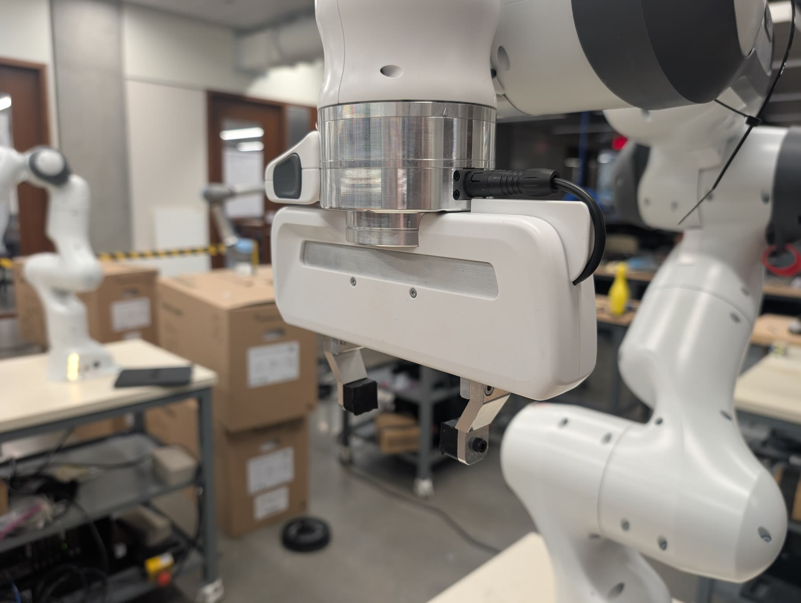
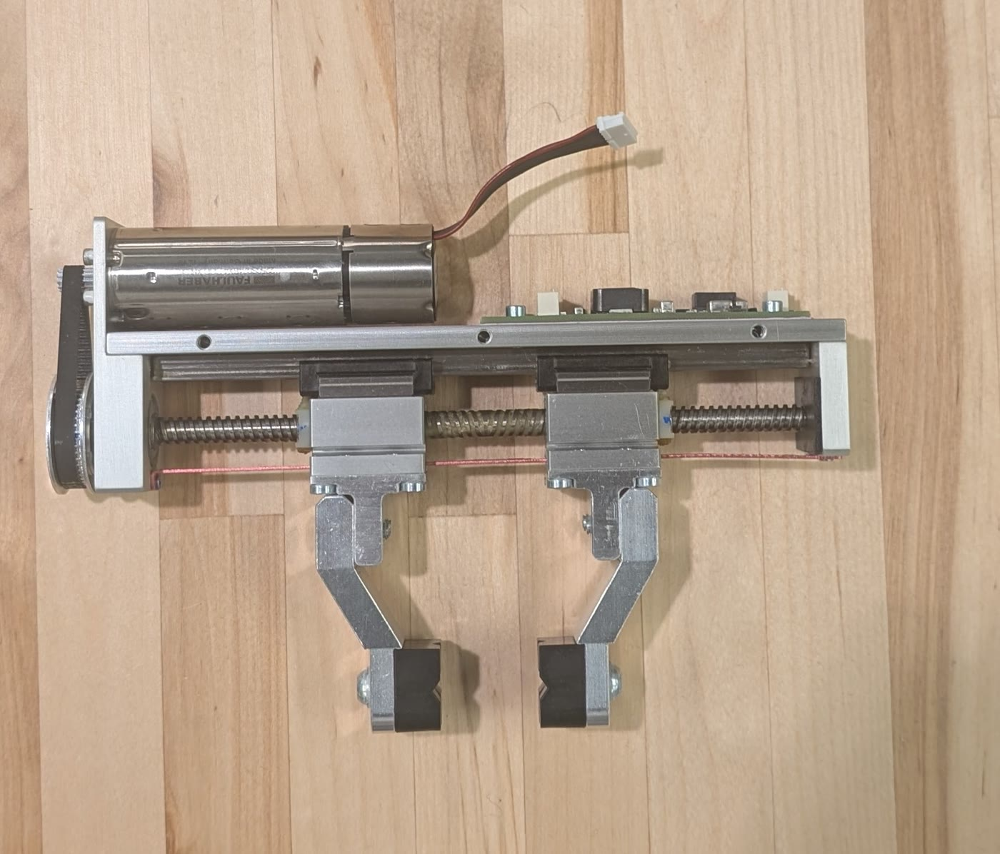
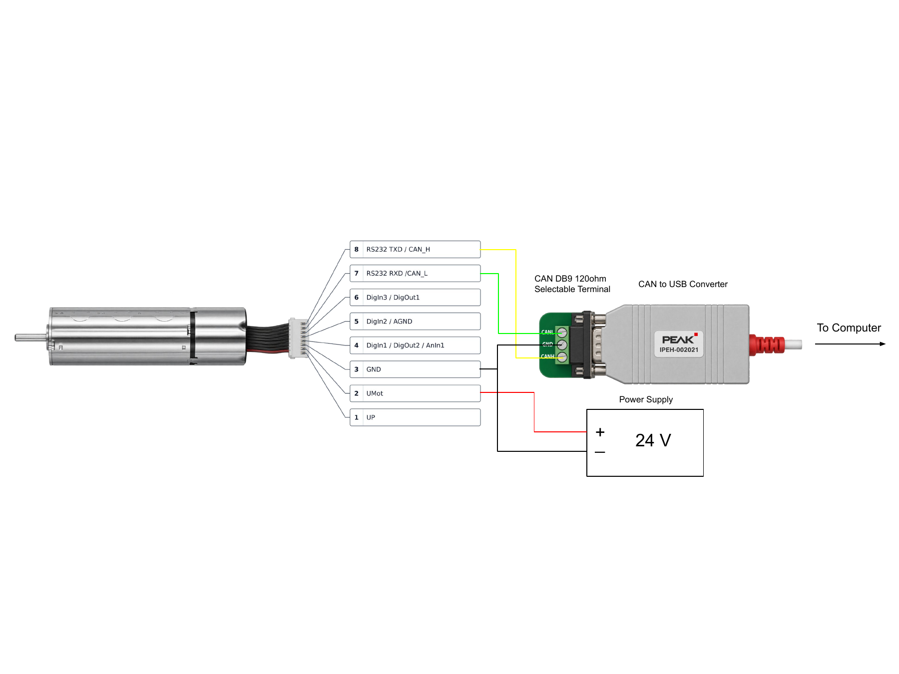
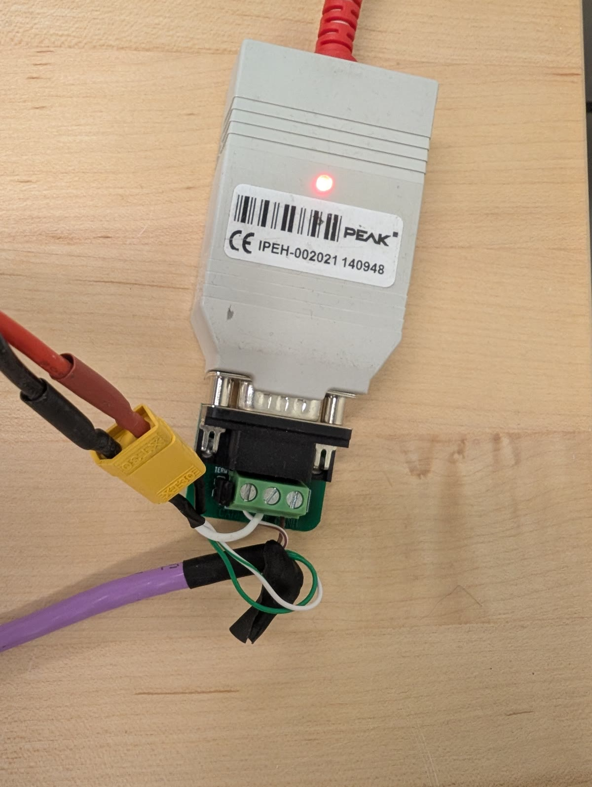
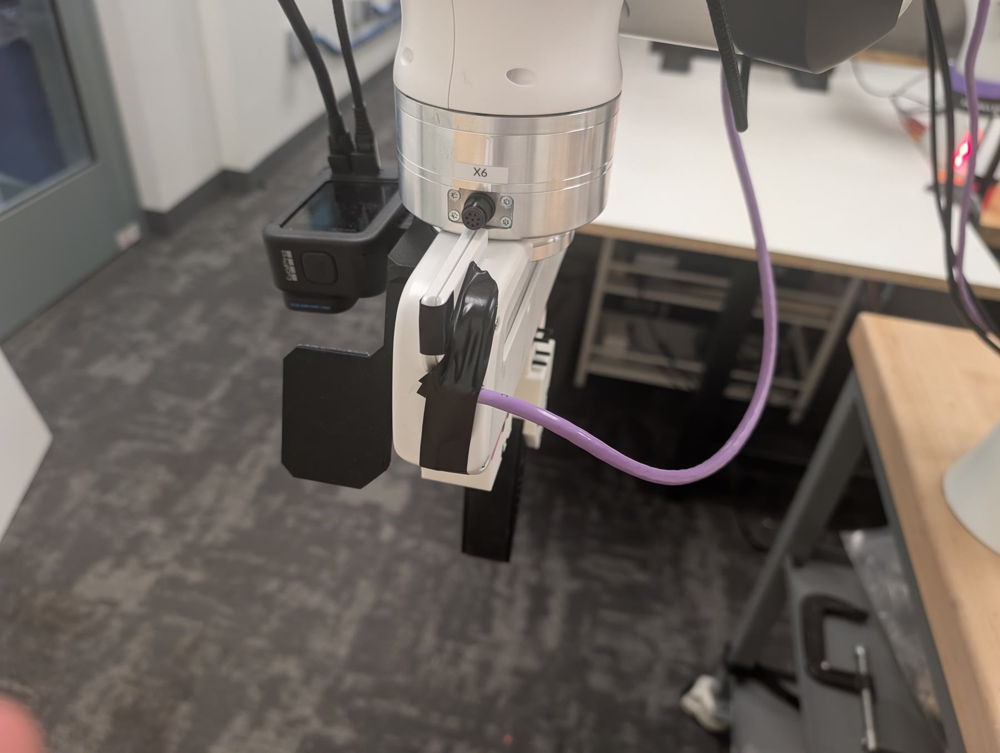

# Hardware build guide

[Project overview and Quickstart](../../README.md) ·
[API and protocol reference](../api/README.md)

This guide describes how to construct the cable and perform the wiring nessesary for directly controling the Franka Hand motor over CAN.

## Step 1: Obtain the components

| Component | Purpose and notes |
|---|---|
| [Purple Cat 6 Ethernet patch cable](https://www.amazon.com/dp/B06XBWPBHK) | Sacrificial multi-conductor cable. |
| [InnoMaker CAN DB9 120-ohm selectable terminal](https://www.amazon.com/dp/B0BD7CDQ31) | Breaks the PCAN adapter's DB9 connection out to `CANL`, `GND`, and `CANH`. It also adds the nessesary 120 Ohm resistor. |
| [MEAN WELL LRS-200-24 power supply](https://www.digikey.com/en/products/detail/mean-well-usa-inc/LRS-200-24/7705026) | Regulated 24 V supply. |
| [DFRobot XT30 male connector, FIT0586](https://www.digikey.com/en/products/detail/dfrobot/FIT0586/9559255) | XT30 connectors to allow easy disconnecting with the power supply. |
| [PEAK PCAN-USB adapter, IPEH-002021](https://phytools.com/products/pcan-usb-adapter) | Connects the CAN bus to the Linux computer over USB. |
| [Molex Pico-SPOX eight-position right-angle header, 0874380843](https://www.digikey.com/en/products/detail/molex/0874380843/699152) | Mating header used to connect the cable harness to the motor connector. |

## Step 2: Remove the gripper mechanism

Detach the Franka Hand from the robot. Disassemble the outer casing and extract its internals. Detach the existing cable that connects the internal PCB the Franka Arm.

*The assembled gripper attached to the Franka Arm before the outer shell is removed.*

*Extracted gripper internals.*

## Step 3: Build the wiring harness

| Motor connection | Function | Connect to |
|---:|---|---|
| 2 | `UMot` | Power-supply `+24 V` |
| 3 | `GND` | Power-supply `-V` and CAN terminal `GND` at the shared ground junction |
| 7 | `CAN_L` | CAN terminal `CANL` |
| 8 | `CAN_H` | CAN terminal `CANH` |

The original, zoomable version is available as
[wiring-diagram.pdf](wiring-diagram.pdf).

Lop off both ends of the ethernet cable. Select five wires within the ethernet cable and use that to wire up up the components as depicted in the wiring diagram. Use XT30 connectors to connect the power and ground wires to the power supply so that power can be easily disconnected. The connections between the ethernet cable, CAN DB9 adapter, and power supply are shown below.

*PCAN-USB adapter, DB9 terminal board, and the purple cable breakout. The wire with the XT30 connector goes to the power supply.*

## Step 4: Reassemble the gripper

Route the purple cable out of the outer shell. You may need to remove some insulation from the ethernet cable so that the wires fit through the hole.

*Reassembled gripper with the purple cable routed out of the closed shell.*

## Step 5: Apply power

Connect the PCAN-USB adapter to the computer. Clear the gripper workspace, keep
an emergency disconnect within reach, and energize the 24 V supply.

Continue with the [Quickstart](../../README.md#quickstart)
to configure `can0`, run the non-moving connection check, and start the ROS 2
node.
